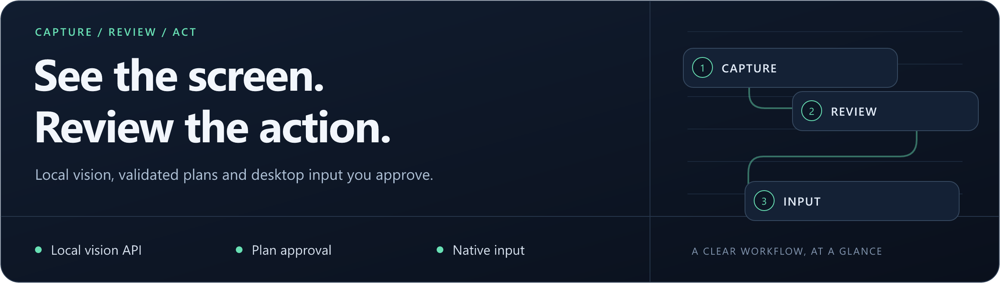

# LocalDesk Agent

<p align="center">
  
</p>

**Desktop automation with a local vision model and an approval step before input.**

Python **3.10+** · Windows / macOS / Linux · Terminal interface

[](https://github.com/rvnsre/localdesk-agent/actions/workflows/ci.yml)

[Quick start](#quick-start) · [Workflow](#how-it-works) · [Profiles](#performance-profiles) · [Documentation](#documentation)

> **Project status:** Desktop/model behavior depends on your machine and permissions. Capture and transport measurements are available; the 2× end-to-end target remains unverified. [Evidence and methodology](docs/benchmarks/README.md).

## Inspect first. Approve before input.

LocalDesk captures the primary display, asks a configured vision-capable API for a structured action plan, validates it and shows the proposed actions for approval. A dry run shows the plan without sending desktop input.

| Local vision | Validated actions | Explicit review |
| --- | --- | --- |
| Screenshots go to your configured model endpoint; loopback is the default. | JSON plans pass coordinate, text, duration and action limits. | Review the plan before input; `--dry-run` never executes it. |

## How it works

```text
Capture → Vision model → Validate → Review + approve → Sequential input
                            |
                  Changed screen? Reject and re-plan.
```

**Any pixel change** between capture and execution rejects the plan. Animation, clocks, blinking cursors or output from the CLI itself can trigger this guard. Keep the terminal on another display when preparing a stable target. Pixel equality is a freshness check, not proof of model correctness.

## Quick start

```bash
git clone https://github.com/rvnsre/localdesk-agent.git
cd localdesk-agent
```

<details open>
<summary><strong>Windows / PowerShell</strong></summary>

```powershell
python -m venv .venv
..venvScriptspython.exe -m pip install -e .
$env:LOCALDESK_BASE_URL = "http://127.0.0.1:1234/v1"
$env:LOCALDESK_MODEL = "your-installed-vision-model"
..venvScriptslocaldesk.exe doctor --json
..venvScriptslocaldesk.exe --dry-run "Find the search field in the current window"
```

</details>

<details>
<summary><strong>Linux / macOS</strong></summary>

```bash
python3 -m venv .venv
.venv/bin/python -m pip install -e .
export LOCALDESK_BASE_URL="http://127.0.0.1:1234/v1"
export LOCALDESK_MODEL="your-installed-vision-model"
.venv/bin/localdesk doctor --json
.venv/bin/localdesk --dry-run "Find the search field in the current window"
```

</details>

Start your local model server first and replace the model placeholder with its exact model ID. It must support image input and JSON mode through an OpenAI-compatible API. Installing LocalDesk does not install or start a model server.

The examples use the venv executable directly; activation is optional. After reviewing dry-run behavior, omit `--dry-run` to request a plan and approval. `localdesk` with no goal starts interactive mode; `/quit` exits.

## Performance profiles

| Profile | Image width | JPEG quality | Response-token ceiling |
| --- | ---: | ---: | ---: |
| `balanced` | 1,280 px | 65 | 900 |
| `fast` | 960 px | 60 | 600 |
| `quality` | 1,920 px | 85 | 1,200 |

`--profile quality --dry-run` favors larger screenshots for small labels. `--profile fast` uses a smaller image and retries an empty plan once with quality settings; it cannot detect every misreading or guarantee equal accuracy.

The runtime calibrates available capture backends and reuses capture resources. This improves the capture path independently of model latency. [Profiles, overrides and benchmarks →](docs/OPERATIONS.md#performance-profiles-and-diagnostics)

## Platform setup

| Platform | Before running |
| --- | --- |
| Windows | Use the active desktop; DXcam can fall back to ImageGrab/MSS when unavailable. |
| macOS | Grant the required Accessibility and Screen Recording permissions to the launcher. |
| Linux | Prefer X11/XWayland. Wayland may restrict capture/input; clipboard typing may need `xclip`, `xsel` or `wl-clipboard`. |

Only the primary monitor is used. Screenshots are sent to the configured endpoint; a local endpoint is needed when screen contents must remain on-device. Unicode/multiline typing temporarily uses the clipboard and may not preserve rich non-text formats.

## Controls to know

- **Stop:** move the pointer to the upper-left corner to trigger the enabled PyAutoGUI fail-safe.
- **Review:** approval is the default. `--yes` deliberately skips that prompt after validation.
- **Freshness:** a changed screen requires a new plan and approval.
- **Boundaries:** shell-like text and system-level hotkeys are blocked by default; plans are not shell commands.
- **Limits:** model output can still be wrong. Review especially carefully before submitting, deleting, sharing or changing accounts.

## Documentation

| Task | Guide |
| --- | --- |
| Configure the model, timeouts and limits | [Environment settings](docs/OPERATIONS.md#configuration) |
| Inspect available commands | [CLI options](docs/OPERATIONS.md#cli-options) · `localdesk --help` |
| Tune capture, image size and tokens | [Profiles and diagnostics](docs/OPERATIONS.md#performance-profiles-and-diagnostics) |
| Understand each runtime library | [Dependency map](docs/DEPENDENCIES.md) |
| Reproduce measurements | [Benchmark methodology](docs/benchmarks/README.md) · [Capture data](docs/benchmarks/capture-windows.json) |
| Review input guards and limitations | [Safety](docs/OPERATIONS.md#safety) · [Platform notes](docs/OPERATIONS.md#platform-notes) |
| Explore the architecture | [Illustrations](docs/OPERATIONS.md#architecture-illustrations) · [Package metadata](pyproject.toml) |

Run the existing test suite with `python -m unittest discover -v`. Mocked desktop actions and local transport tests do not establish real model accuracy. [Report a software issue](https://github.com/rvnsre/localdesk-agent/issues/new) with redacted diagnostics, never private screen captures or credentials.

---

**More from rvnsre:** [Extreme Autopilot](https://github.com/rvnsre/extreme-autopilot) · [MedResearch](https://github.com/rvnsre/medresearch-cli) · [ForgeFlow CLI](https://github.com/rvnsre/forgeflow-cli)
